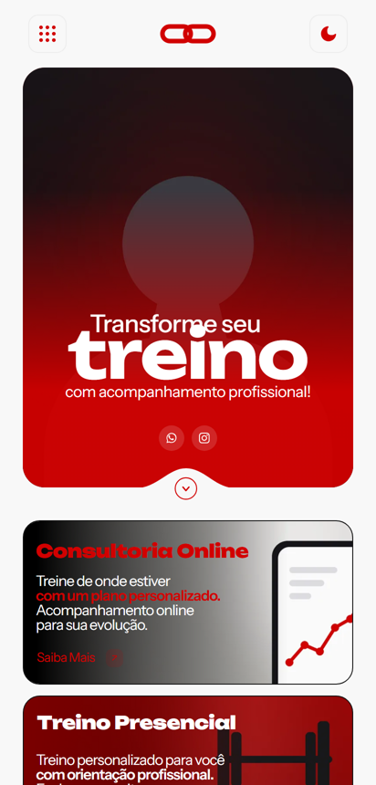
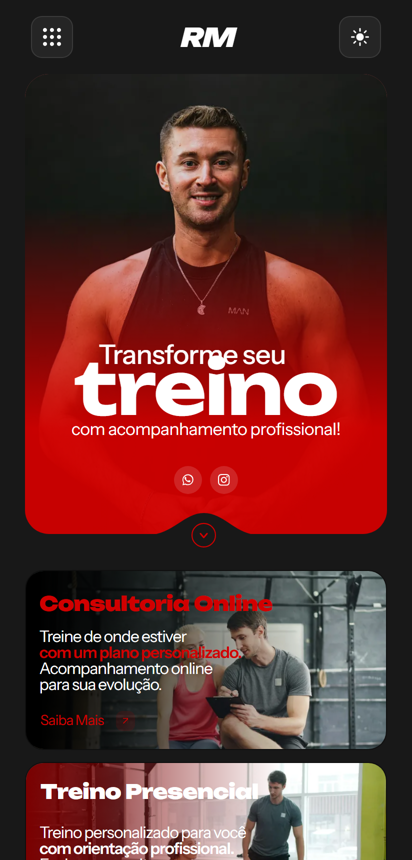
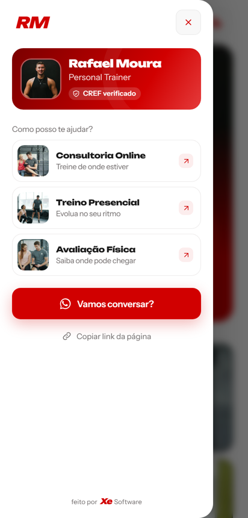
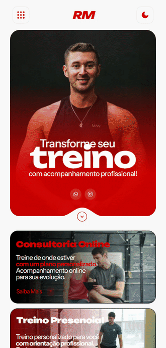
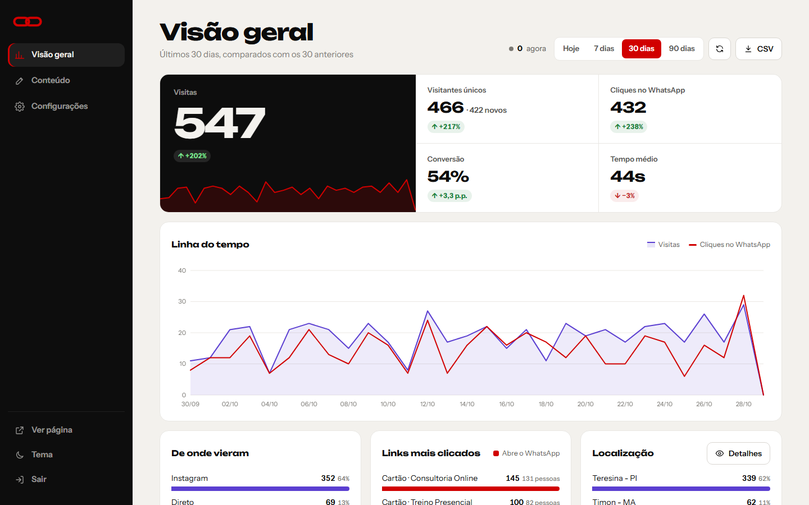
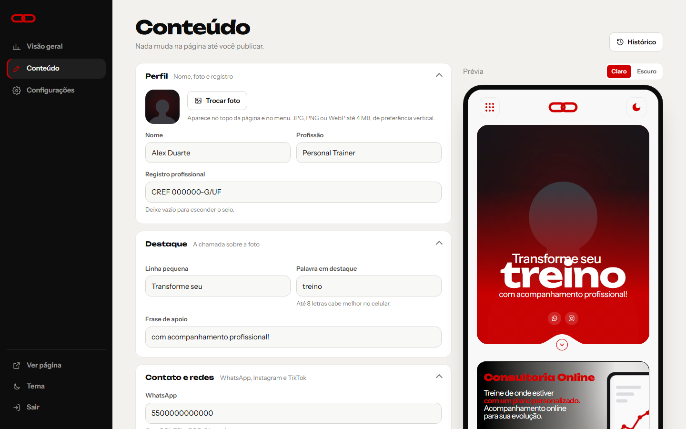
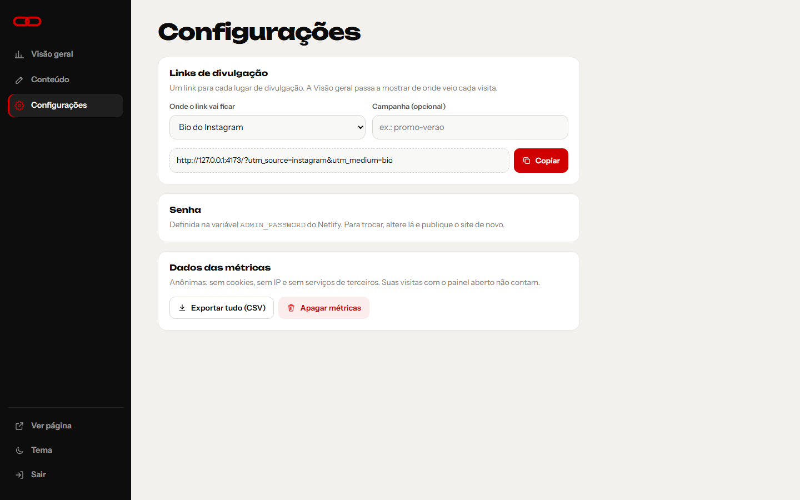

<div align="center">

# Link na Bio

**Página de links profissional para quem vende pelo Instagram: transforma cada visita da bio em uma
conversa no WhatsApp, com painel de edição e métricas próprias.**


</div>

https://github.com/user-attachments/assets/83f6a9e5-fe30-4088-8f74-a7f492a0287c

---

## Contexto

Este projeto nasceu de um trabalho sob encomenda para um personal trainer. Perfis de redes sociais
têm espaço para um único link, e a página ocupa esse espaço: em poucos segundos ela mostra quem é o
profissional, quais serviços ele oferece e como contratá-lo, com um toque para abrir o WhatsApp já
com a mensagem pronta.

**Esta é a versão pública do código.** O nome, o registro profissional, os contatos e as fotos do
cliente foram trocados por uma persona fictícia, "Rafael Moura", com o selo "CREF verificado" no lugar
do número do registro. As fotos são do [Unsplash](https://unsplash.com/license), de uso livre. O
código e o funcionamento são os mesmos da versão entregue.

O design foi implementado a partir de um projeto no Figma, nos temas claro e escuro, pensado primeiro
para o celular, onde está quase todo o público.

## A página

| Tema claro | Tema escuro | Menu |
|:---:|:---:|:---:|
|  |  |  |

- **Destaque de impacto** com foto, chamada principal e atalhos para WhatsApp e Instagram.
- **Cartões de serviço** (Consultoria Online, Treino Presencial e Avaliação Física) com estilos
  diferentes e texto com negrito.
- **WhatsApp com mensagem personalizada por serviço:** cada clique já chega dizendo qual serviço a
  pessoa quer, o que agiliza o atendimento.
- **Menu** com perfil, selo do registro profissional, atalhos dos serviços e "Vamos conversar?".
- **Tema claro e escuro:** segue a preferência do aparelho, pode ser trocado e a escolha fica salva.
- **Copiar e compartilhar o link** da página.



Gravação da página no celular, com a troca de tema e o menu:

https://github.com/user-attachments/assets/f8cc0895-f872-4220-806d-6f7f9993f07f

## O painel de administração

O dono da página edita tudo e acompanha os resultados em `/admin`, sem precisar de programador.



**Visão geral:** por período (hoje, 7, 30 ou 90 dias), comparando com o período anterior.

- visitas, visitantes únicos, cliques no WhatsApp, taxa de conversão, tempo médio e rolagem;
- linha do tempo por hora ou por dia e horários de pico (dia da semana × hora);
- de onde vieram as visitas (Instagram, WhatsApp, Google, direto...) e campanhas;
- localização, dispositivo, sistema e navegador;
- ranking dos botões mais clicados e **mapa de calor** dos cliques sobre a página;
- visitas recentes com a jornada de cada uma, pessoas na página agora e exportação em CSV.



**Conteúdo:** perfil e foto, chamada principal, WhatsApp e mensagens, Instagram e TikTok, serviços
(adicionar, remover, reordenar, ocultar, trocar foto e estilo do cartão), menu, título e descrição
para o Google e rodapé. Tudo com **prévia ao vivo** nos dois temas; a página só muda ao clicar em
Publicar, e cada publicação fica no **histórico** para ser restaurada.



**Configurações:** gerador de **links de divulgação** com `utm_source` (bio do Instagram, stories,
status do WhatsApp, QR code...) para saber de onde veio cada visita, troca de senha e gestão dos
dados.

Gravação do painel, trocando o período das métricas e editando o conteúdo com prévia ao vivo:

https://github.com/user-attachments/assets/27e664a6-6adc-4567-b918-1af4818c3aa6

O planejamento completo do painel está em [`docs/painel-admin.md`](docs/painel-admin.md).

## Como foi construído

```
server/              servidor Node sem dependências: página, API do painel, login e métricas
  page.html          estrutura da página, preenchida com o conteúdo publicado
  content.mjs        conteúdo padrão e sanitização de tudo que vem do painel
  analytics.mjs      agregação das métricas (origem, dispositivo, conversão, mapa de calor)
  auth.mjs           senha do painel, sessão e limite de tentativas de login
admin/               painel de administração (HTML, CSS e JavaScript puros)
netlify/             função serverless e armazenamento em Netlify Blobs para a hospedagem
app.js · track.js    menu, tema e o coletor de métricas anônimas da página
scripts/             build estático e modo demonstração com 45 dias de visitas fictícias
```

Decisões técnicas que valem destacar:

- **Sem frameworks e sem dependências no navegador.** HTML, CSS e JavaScript puros, fotos em WebP
  com alternativa em JPG e fontes hospedadas junto com o site: a página abre rápido até em conexão
  fraca.
- **Renderização no servidor.** O HTML já sai pronto com o conteúdo publicado e os links do
  WhatsApp montados, sem esperar JavaScript.
- **Duas hospedagens, o mesmo código.** O servidor Node guarda os dados em arquivos (`kv-file.mjs`);
  na Netlify, uma função serverless usa o Netlify Blobs (`kv-blobs.mjs`) pela mesma interface.
- **Entrada sempre sanitizada.** Todo campo do painel passa por limites de tamanho, remoção de
  caracteres de controle, URLs só `https` e imagens só do próprio site.
- **Privacidade.** Métricas anônimas e próprias: sem cookies na página, sem guardar IP e sem serviços
  de terceiros.
- **Segurança do painel.** Senha com hash scrypt e comparação em tempo constante, sessão em cookie, limite de tentativas de login, `noindex`
  e cabeçalhos de segurança nas rotas do painel.
- **Acessibilidade.** Navegação por teclado, foco visível, áreas de toque de pelo menos 44 px, textos
  alternativos e respeito a quem prefere menos animação. Responsivo de 320 px até telas grandes.

## Rodar localmente

Requer apenas [Node.js](https://nodejs.org) 20 ou mais recente. A página e o servidor não têm
dependências; as duas do `package.json` são usadas só na hospedagem da Netlify.

```sh
npm run dev       # página em http://127.0.0.1:4173 e painel em /admin
npm run demo      # mesmo servidor com 45 dias de visitas fictícias (senha do painel: demo1234)
npm run check     # valida a sintaxe de todos os scripts
npm run build     # gera um retrato estático em dist/ (sem painel nem métricas)
```

No primeiro acesso local ao painel é pedido para criar a senha. Em produção, hospede o servidor Node
(Render, Railway, Fly.io, VPS...) com `npm start`, ou use a Netlify com `npm run build:netlify`, e
configure:

| Variável         | Uso                                                                        |
| ---------------- | -------------------------------------------------------------------------- |
| `ADMIN_PASSWORD` | Senha do painel (obrigatória em produção se nenhuma senha foi criada)       |
| `HOST` / `PORT`  | Endereço do servidor; use `HOST=0.0.0.0` em hospedagens                    |
| `DATA_DIR`       | Pasta persistente para conteúdo e métricas (padrão: `data/`)               |
| `TRUST_PROXY=1`  | Quando há proxy ou CDN na frente (HTTPS e IP real para o limite de login)  |

> A cidade aparece nas métricas quando o site está atrás do Cloudflare (com "Add visitor location
> headers") ou da Vercel. Em outras hospedagens, a localização é aproximada pelo fuso horário do
> aparelho.

## Créditos

- Desenvolvimento: **Emanuel Cândido** ([Xe Software](https://github.com/EmanuelCandido/XeSoftware)).
- Fontes: [Unbounded](https://github.com/googlefonts/unbounded) e
  [Instrument Sans](https://github.com/Instrument/instrument-sans), licença SIL OFL 1.1 (textos em
  `assets/`).
- Fotos da persona fictícia: [Unsplash](https://unsplash.com/license).
